### BreastGuard Mobile

**Mobile App for Breast Cancer Image Classification and Screening Support**

BreastGuard Mobile is the React Native/Expo mobile application for the BreastGuard system. The app allows users to capture or upload breast cancer medical images, send them to an AI-powered backend, and receive a binary classification result indicating whether the image is predicted as **benign** or **malignant**.

The mobile app is designed for students, researchers, healthcare learners, and medical decision-support experiments that require fast and accessible breast cancer image classification from a mobile device.

> **Important:** BreastGuard is an AI decision-support tool. It does **not** provide a medical diagnosis and should not replace professional clinical advice, biopsy, laboratory testing, or consultation with qualified healthcare professionals.

### What the App Does

BreastGuard Mobile follows a simple AI prediction workflow:

```text
Breast Cancer Image
   ↓
Image Upload or Camera Capture
   ↓
AI-Powered Classification
   ↓
Benign or Malignant Prediction
   ↓
Confidence Score
   ↓
Saved Prediction History
```

The app analyzes the selected image and returns a prediction result with a confidence score. The current mobile version does **not** use Grad-CAM explanations.

### Features

- Capture a breast image using the camera
- Upload a breast image from the gallery
- Classify images as **benign** or **malignant**
- Display prediction confidence scores
- Show prediction results in real time
- Save prediction history locally
- View recent prediction history
- Enable or disable prediction history saving
- Enable or disable haptics and sounds
- Lock the app using biometrics, passcode, or PIN
- Clear prediction history
- Restore default settings
- Access Terms and Conditions
- Access Privacy Policy
- Share the app with a friend
- Rate BreastGuard
- Report an issue

### Supported Classes

BreastGuard currently supports binary breast cancer image classification.

```ts
["benign", "malignant"];
```

| Class       | Meaning                                      |
| ----------- | -------------------------------------------- |
| `benign`    | The uploaded image is predicted as benign    |
| `malignant` | The uploaded image is predicted as malignant |

> The class labels should match the trained backend model labels to preserve correct class-index mapping.

### App Screenshots

The screenshots are stored in the root project [`screenshots`](./screenshots) folder.

### Splash and Onboarding

<p align="center">
  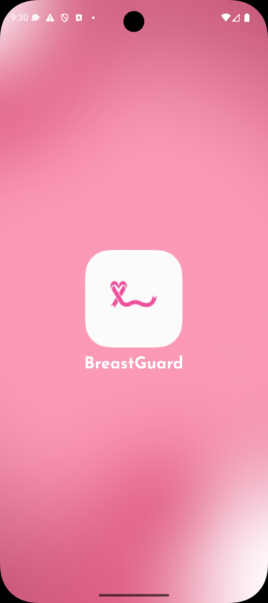
  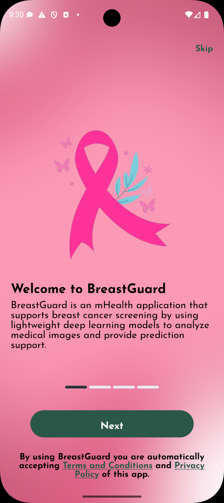
  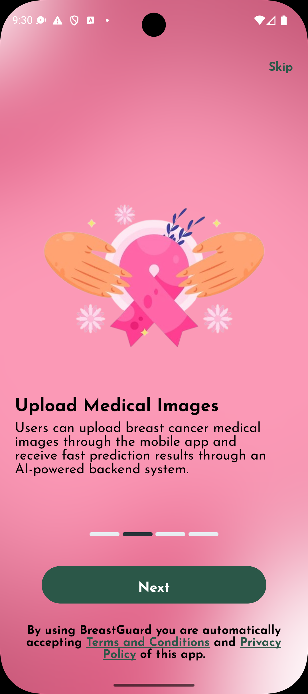
  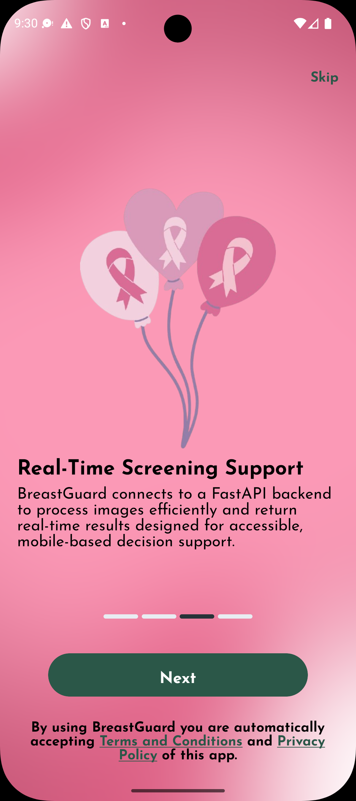
  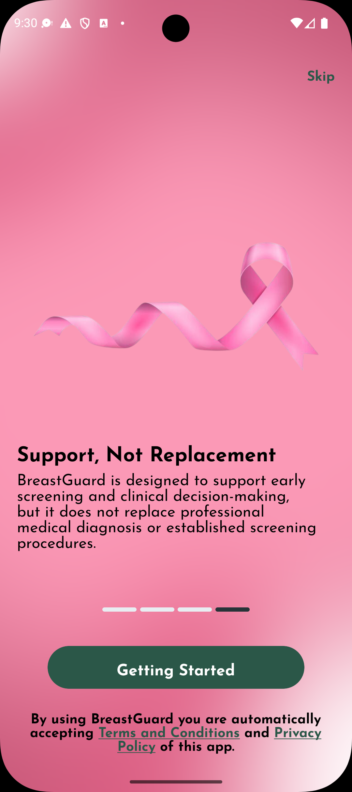
</p>

### App Lock and Home

<p align="center">
  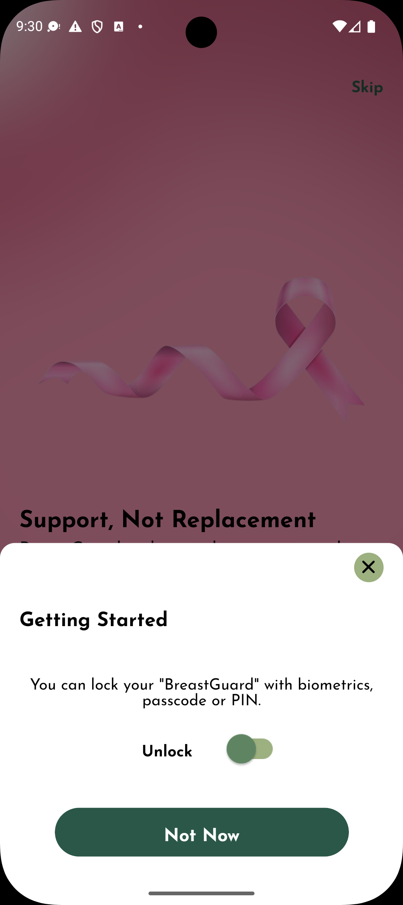
  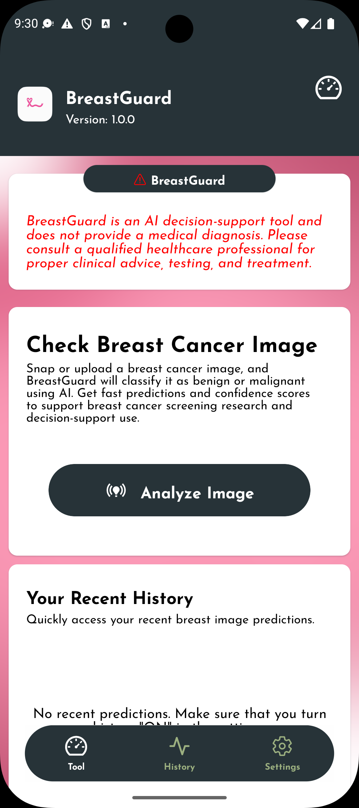
</p>

### Settings

<p align="center">
  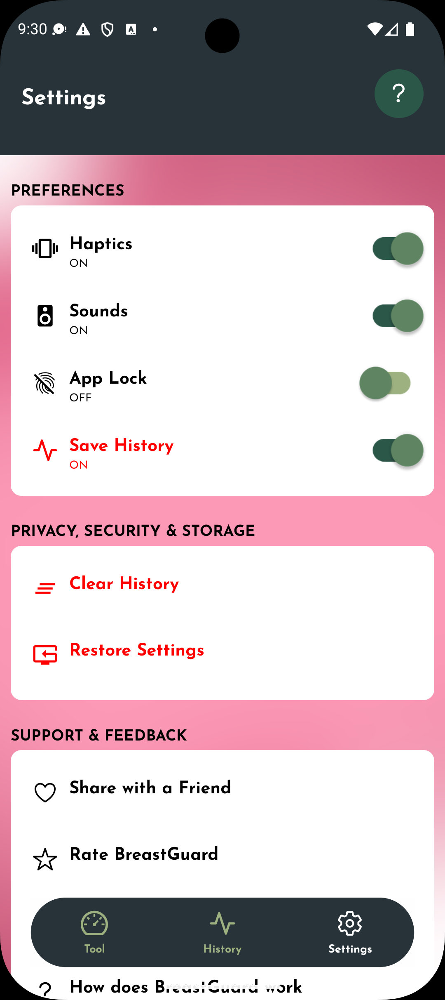
  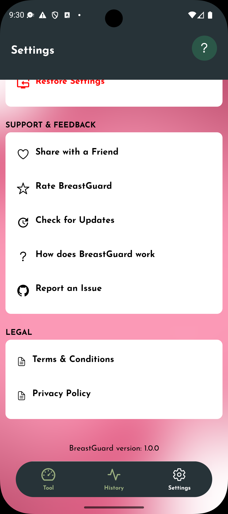
</p>

### Image Selection and Prediction

<p align="center">
  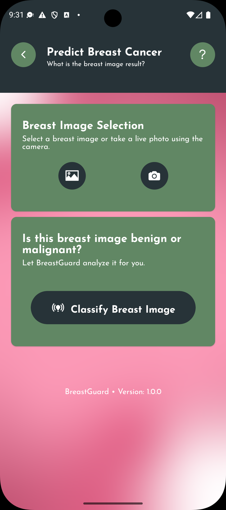
  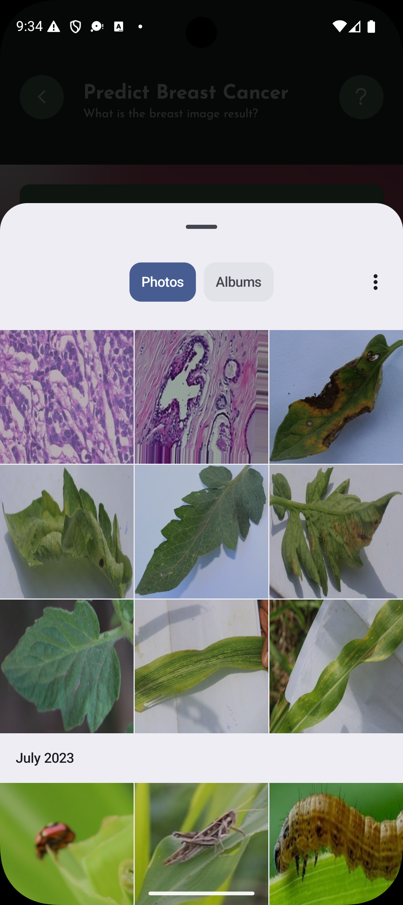
  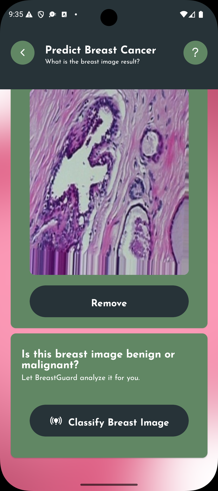
</p>

### Results and History

<p align="center">
  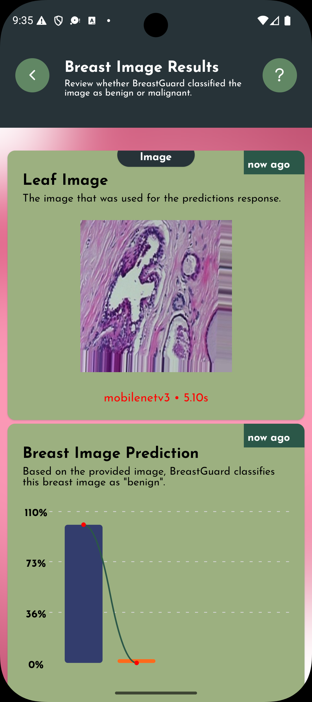
  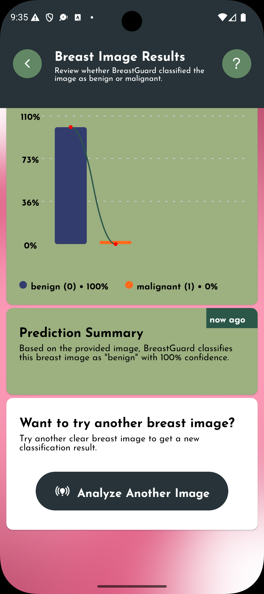
  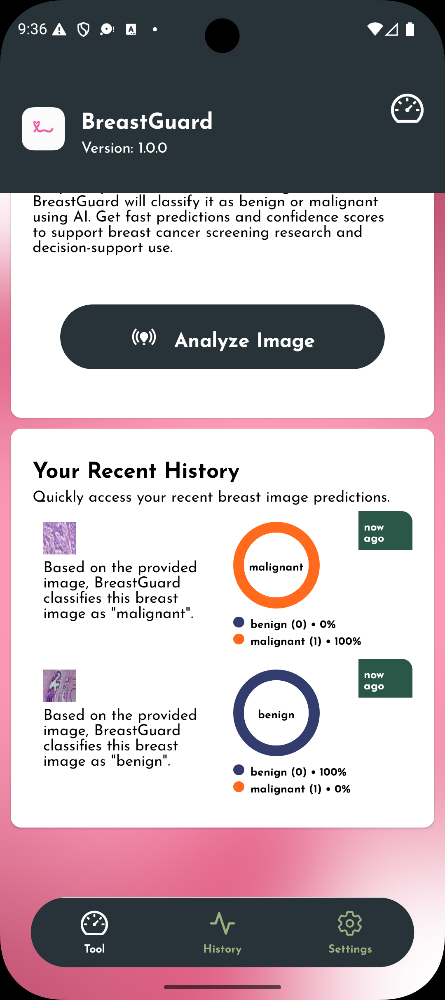
</p>

### Tech Stack

| Tool                           | Purpose                                    |
| ------------------------------ | ------------------------------------------ |
| React Native                   | Mobile app development                     |
| Expo                           | Development, build, and device testing     |
| TypeScript                     | Type-safe app logic                        |
| React Navigation / Expo Router | App navigation                             |
| TanStack Query                 | API request and mutation handling          |
| Async Storage / local storage  | Saving preferences and prediction history  |
| Expo Image Picker              | Selecting images from the gallery          |
| Expo Camera / Image Picker     | Capturing images                           |
| FastAPI backend                | AI inference server                        |
| PyTorch                        | Deep learning model training and inference |

### Getting Started

### 1. Install Dependencies

From the `mobile` directory, run:

```shell
npm install
```

or:

```shell
yarn install
```

### 2. Configure the API Base URL

Make sure the mobile app points to the running BreastGuard backend.

For Android emulator:

```ts
const SERVER_BASE_URL = "http://10.0.2.2:8000/api/v1/breastguard";
```

For iOS simulator:

```ts
const SERVER_BASE_URL = "http://127.0.0.1:8000/api/v1/breastguard";
```

For a physical phone on the same Wi-Fi network:

```ts
const SERVER_BASE_URL = "http://192.168.1.50:8000/api/v1/breastguard";
```

Replace `192.168.1.50` with your computer's local IPv4 address.

> Update the route above if your backend uses a different API prefix.

### 3. Start the App

```shell
npx expo start
```

Then open the app using:

- Expo Go on a physical device
- Android emulator
- iOS simulator

### Backend Requirement

The mobile app requires the BreastGuard FastAPI server to be running.

From the root project:

```shell
cd server
uvicorn app:app --host 0.0.0.0 --port 8000
```

The backend should expose a prediction endpoint similar to:

```http
POST /api/v1/cancer/predict
```

### Prediction Request

The app sends a `multipart/form-data` request to the backend.

### Request Fields

| Field   | Type | Required | Description                                          |
| ------- | ---- | -------: | ---------------------------------------------------- |
| `image` | File |      Yes | Breast cancer image selected or captured by the user |

Example request from the app:

```ts
const formData = new FormData();

formData.append("image", image);

const res = await fetch(`${SERVER_BASE_URL}/predict`, {
  method: "POST",
  body: formData,
});
```

### Example API Response

```json
{
  "time": 0.06592509997426532,
  "ok": true,
  "status": "ok",
  "prediction": { "label": 0, "class_label": "benign", "probability": 1.0 },
  "model": "mobilenetv3",
  "id": "7c3845a6-1b8c-4e62-8734-c5b1713731db"
}
```

### Prediction Output

A saved prediction result may include:

- Uploaded image
- Predicted class label
- Confidence score
- Model name
- Prediction time
- Benign probability
- Malignant probability
- Timestamp
- Local history item

Example app result text:

```text
Based on the provided image, BreastGuard classifies this breast image as "benign" with 100% confidence.
```

### Settings

The app includes settings for:

- Haptics
- Sounds
- App Lock
- Save History
- Clear History
- Restore Settings
- Share with a Friend
- Rate BreastGuard
- Check for Updates
- Help / How BreastGuard Works
- Report an Issue
- Terms and Conditions
- Privacy Policy

### Prediction History

When history is enabled, the app saves recent prediction results so users can quickly review previous breast image classifications.

A saved history item may include:

- Breast image
- Prediction label
- Confidence score
- Probability chart values
- Model name
- Prediction time
- Timestamp

### Development Notes

### Clear Metro Cache

```shell
npx expo start --clear
```

### Run Type Checking

```shell
npx tsc --noEmit
```

### Install a Package

```shell
npx expo install package-name
```

### Important Notice

> BreastGuard is a breast cancer image classification decision-support tool. It is designed to support research, learning, and screening-support workflows, but it does **not** replace professional medical diagnosis, clinical examination, biopsy, laboratory testing, or treatment guidance from qualified healthcare professionals.

Users should consult a qualified healthcare professional for proper clinical advice, testing, diagnosis, and treatment.

### License

This project is licensed under the [MIT License](../LICENSE).
